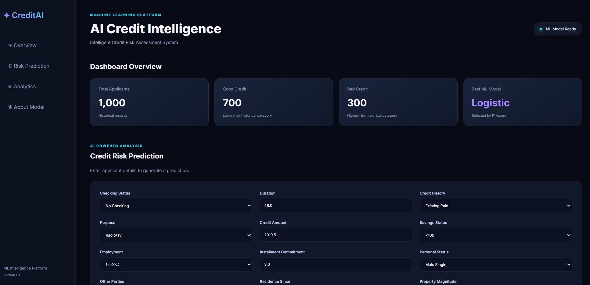
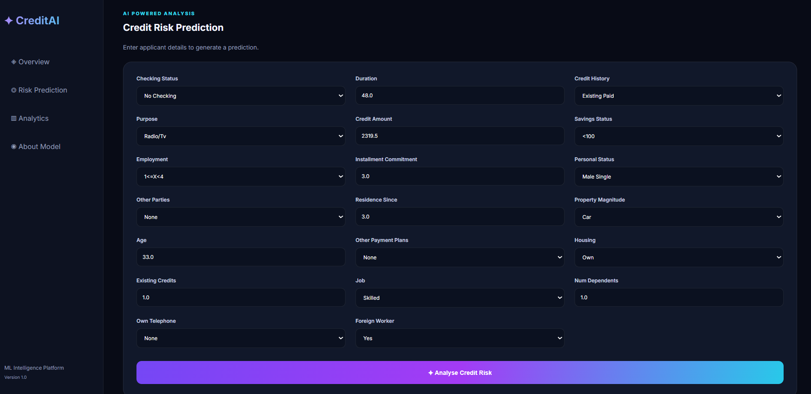
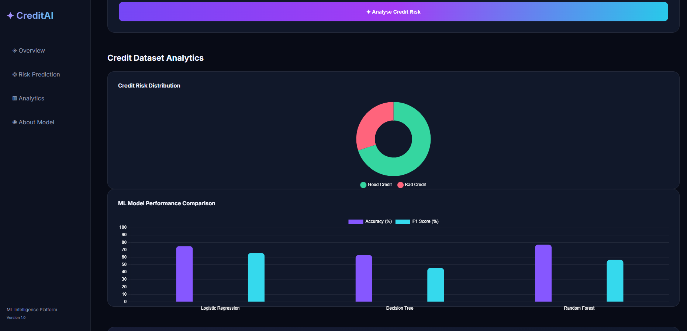
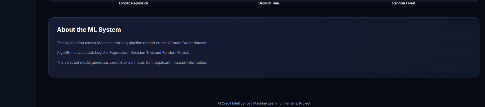

# CreditAI – AI Credit Intelligence

### An Explainable Machine Learning-Based Credit Risk Assessment System

CreditAI is an AI-powered credit risk assessment application that uses Machine Learning to analyze applicant information and predict credit risk. It provides interpretable predictions with SHAP (SHapley Additive exPlanations), helping users understand the factors influencing each prediction.

## 🎯 Project Objective

The main objective of CreditAI is to develop an intelligent credit risk assessment system that predicts whether an applicant has good or bad credit risk based on financial and personal attributes.

The system combines Machine Learning, an interactive web dashboard, and Explainable AI to make predictions easier to understand.

## ✨ Key Features

- **Credit Risk Prediction:** Predicts Good Credit or Bad Credit.
- **Machine Learning Models:** Uses Logistic Regression, Decision Tree, and Random Forest for model comparison.
- **Prediction Probabilities:** Displays the model's prediction probabilities.
- **Explainable AI:** Uses SHAP to explain the factors influencing individual predictions.
- **Feature Importance:** Displays the top five factors contributing to a prediction.
- **Interactive Dashboard:** Provides credit risk distribution and model performance visualizations.
- **Web Application:** User-friendly interface built using Flask, HTML, CSS, and JavaScript.

## 🛠️ Technologies Used

| Component | Technology |
|---|---|
| Programming Language | Python |
| Backend | Flask |
| Machine Learning | Scikit-learn |
| Explainable AI | SHAP |
| Data Processing | Pandas, NumPy |
| Frontend | HTML, CSS, JavaScript |
| Visualization | Chart.js |
| Dataset | German Credit Dataset |

## 🏗️ Project Structure

```text
CreditAI/
│
├── app.py
│
├── dataset/
│   └── credit_data.csv
│
├── models/
│   ├── credit_model.pkl
│   ├── model_metadata.json
│   ├── feature_schema.json
│   ├── model_comparison.csv
│   ├── shap_global_importance.csv
│   ├── shap_feature_names.json
│   └── shap_background.pkl
│
├── static/
│   ├── css/
│   │   └── style.css
│   └── js/
│       └── script.js
│
└── templates/
    └── index.html
```

## ⚙️ How It Works

1. The user enters applicant information through the web interface.
2. The application processes the input data.
3. The trained Machine Learning model analyzes the information.
4. The system predicts the applicant's credit risk.
5. Prediction probabilities are displayed on the dashboard.
6. SHAP explainability identifies the important factors influencing the prediction.

## 🚀 Installation and Execution

### 1. Clone the repository

```bash
git clone https://github.com/SUBHASH-REDDY7/CreditAI.git
```

### 2. Navigate to the project directory

```bash
cd CreditAI
```

### 3. Install the required libraries

```bash
pip install flask pandas numpy scikit-learn shap joblib
```

### 4. Run the application

```bash
python app.py
```

### 5. Open the application

Open the following address in your browser:

```text
http://127.0.0.1:5000/
```

## 🧠 Explainable AI – SHAP

CreditAI integrates SHAP to improve the interpretability of Machine Learning predictions.

It helps users understand:
- Which input features influence a prediction.
- Which factors contribute positively or negatively.
- The most influential factors for an individual applicant.

## 📊 Model Evaluation

The project compares three Machine Learning algorithms:

- Logistic Regression
- Decision Tree
- Random Forest

The model comparison results are stored in the `models/` directory.

## 🔮 Future Enhancements

- Live cloud deployment.
- Additional Machine Learning algorithms.
- Improved model validation and calibration.
- Detailed credit risk analytics.
- Enhanced interactive visualizations.

## ⚠️ Disclaimer

CreditAI is an educational and academic project developed for learning and demonstration purposes. Its predictions are model estimates and must not be used as the sole basis for actual lending or financial decisions.

## 👨‍💻 Project Information

**Project Name:** CreditAI – AI Credit Intelligence  
**Domain:** Artificial Intelligence and Machine Learning  
**Application Type:** Machine Learning-Based Web Application  
**Repository:** https://github.com/SUBHASH-REDDY7/CreditAI

## 📸 Project Screenshots

### 1. CreditAI Dashboard


### 2. Analytics Dashboard


### 3. Good Credit Prediction


### 4. Bad Credit Prediction


---

*Developed as an academic project to demonstrate Machine Learning, Flask-based application development, and Explainable Artificial Intelligence.*
